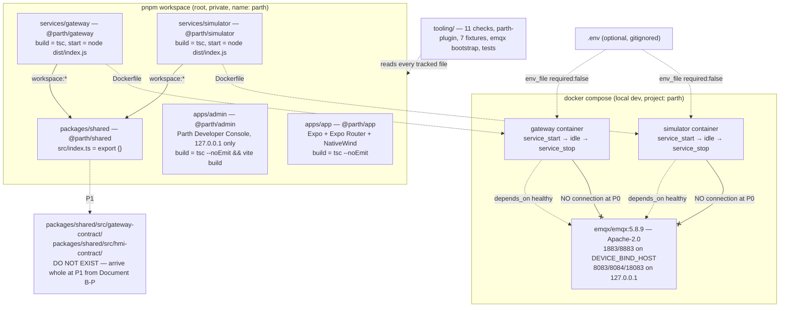

# Design Document: P0 Foundations

## Overview

P0 creates a pinned, strict-TypeScript pnpm monorepo with five packages, the ported repo-check suite plus one new check, a Supabase CLI scaffold, a local Compose stack (EMQX plus a gateway and a simulator) and the approved connection panel. No product behaviour ships and no wire behaviour ships.

Almost all of it is a port from `.reference/xelulu`, which is read-only. That makes P0 unusual: most of the work is *transcription under a rename rule*, and the only places where judgement is exercised are the three places the reference cannot answer, because Parth has something Xelulu does not and lacks something Xelulu has.

| The three places P0 is not a port | Why |
|---|---|
| **`tooling/checks/layer.ts` and its test** | Xelulu has no layer rule. Parth has three layers, a two-tier banned-string list and a capped escape hatch, and all of it has to be enforceable from the first commit or the P5 extraction becomes archaeology. |
| **`.env.example` and `approved-panel.txt`** | The panel is this product's, in comment-above-key form, with no OTA signing key and no box for an unbuilt feature. The approved fixture is generated from it, not ported. |
| **The reduced service lifecycle** | Xelulu's `gateway.ts` and `simulator.ts` are wired to the contract. Parth has no contract. P0 needs a service that starts, logs, idles and stops, so it gets a small `lifecycle.ts` that P2 deletes. |

Everything else in P0 either ports under the rename rule, or is named in the Deferral_Register in `tasks.md`.

All "behaviour" in this phase lives in the repo checks, which are pure functions, plus the service lifecycle, which is a small state machine over two signals. Those are the only real logic, so those are what get property tests.

Recorded on **20 October 2026**. That date fixes nothing by itself, because every pin is copied from the Reference_Repo rather than resolved (P0-C9). The one exception is the Expo SDK, which is resolved in Task 1.

### Choices and FLAGs

The spec's choices and FLAGs are in `requirements.md` (P0-C1 through P0-C10, P0-F1 through P0-F5) and are not restated. The design decisions below are additional, and are about *how*, not *whether*.

### Key design decisions

| # | Decision | Rationale |
|---|---|---|
| D1 | **Every pin is read out of `.reference/xelulu/package.json` and copied.** No `pnpm view`, no "latest", no re-resolution. | The ported checks, tests and CI are written against those versions. `exact-version.ts` would pass on a drifted set and the tests would then fail for reasons that look like Parth bugs. Document A-P C6 is explicit: version drift costs more than it buys. |
| D2 | **`layer.ts` is a pure module with the same shape as `panel.ts`**: text and fixture in, findings out, no filesystem access. The loader lives in `tooling/test/layer.test.ts`. | It matches the nine checks beside it, so it is property-testable, and a finding can never carry source text or a matched string - which matters, because a matched string is by definition a product secret-adjacent token. |
| D3 | **The banned tiers are a JSON fixture, not a constant in `layer.ts`.** | The membership is Document A-P section 8's, and it has already changed once: v1.2 took the ordinary English words out and added five vendor package names. A fixture makes the next amendment a one-file edit with no code change and no test change. It also keeps `layer.ts` itself free of banned strings, which Requirement 4.9 demands and which a hard-coded list makes impossible. |
| D15 | **A module specifier is never scanned by either tier.** | A reading of A-P section 8, which already separates specifiers from content. Without it `@parth/shared` trips Tier A in every platform file that uses the contract from P2 onward: the workspace's own scope would be a banned string. The import rule governs specifiers and it governs them correctly. |
| D16 | **`eslint.config.mjs` and `tooling/eslint/parth-plugin.mjs` are infrastructure: excluded from layer labelling entirely, not labelled `product`.** The list is written out in `layer.ts` and length-asserted in `layer.test.ts`. | `structure.md` already says repo infrastructure is not a package; this extends it to the layer check, the same way `package.json` and `docker-compose.yml` are outside it. `product` would have been wrong even though its outcome was right, because the `product` label **grants the right to import from a product path**, which neither file may ever do. Excluding withholds the check without granting anything. The length assertion is what stops the list becoming a dumping ground. |
| D4 | **Tier B is matched with a tokeniser, not a regex over raw text.** `layer.ts` splits a file into comment spans, string-literal spans and code spans first, then matches Tier A over the whole text and Tier B over identifier and literal spans only. | A whole-word regex over raw text cannot tell `// focus on the envelope` from `const focus = …`. The span split is about forty lines and is the only honest way to implement "never in comments". |
| D5 | **The span split is deliberately conservative and line-based.** A template literal with an embedded expression is treated as one literal span; a regex literal is treated as code. | A full TypeScript parse would be correct and would also make the check depend on the TypeScript compiler API, which the other nine checks do not. A conservative split can only ever produce a *false finding*, never a missed one, and a false finding is an argument you have at review time rather than a hole. |
| D6 | **The Import_Rule reads module specifiers only, with no resolution against the filesystem.** A specifier is in-repository if it is relative, or begins `@parth/`. Anything else is external and is never a finding. | Requirement 4.5. It is also why `zod` in the contract layer and `mqtt` in the platform layer are not violations: the check never even looks at them. |
| D7 | **The Escape_Hatch is counted across the repository by the test, not by the check.** `layer.ts` reports a suppressed finding as a `hatch` record; `layer.test.ts` sums them and fails above five. | The check is pure and sees one file at a time. A cap is a whole-repository fact, so it belongs to the loader. |
| D8 | **The two services share their P0 source almost exactly**, and the shared files are copied rather than extracted into a sixth package. | The reference does the same: `backoff.ts`, `clock.ts`, `crash.ts`, `deadlines.ts`, `ids.ts` and `listen-host.ts` exist twice, byte-identical. Extracting them now would mean inventing a platform package boundary at P0, which is exactly what Document A-P C1 defers to after P5. |
| D9 | **The services idle on one referenced `setInterval` that does nothing.** No `stdin.resume()`, no unresolved promise, no `setTimeout` chain. | An interval is the only idle primitive that is trivially observable in a test (`unref`/`ref` state), survives a `SIGTERM` handler being attached, and costs no measurable CPU. `stdin.resume()` behaves differently under Compose with no TTY. |
| D10 | **The Startup_Line and Shutdown_Line are single-line JSON**, emitted through the ported Logger, with a fixed key order. | Single-line JSON is greppable from `docker compose logs`, assertable by exact match in a test, and it is the shape the reference Logger already produces, so P2 does not change the format when real log entries arrive. |
| D11 | **No Compose healthcheck for the two services** (P0-C6), and `depends_on: service_healthy` on EMQX is kept anyway. | Keeping the dependency edge means P2 adds a healthcheck and changes nothing else. Adding a P0 healthcheck would mean inventing a probe - a liveness file or an HTTP port - that P2 immediately replaces with the operator CLI. |
| D12 | **`tooling/test/layout.test.ts` and `readme.test.ts` are ported with their contract assertions removed, not skipped.** The removed assertions are listed in the Deferral_Register with P1 as the restoring phase. | A skipped test reads as a known failure. A narrowed test with a register entry reads as a decision. Requirement 5.6 forbids weakening a test in place of deferring it; narrowing a *real-repo layout* assertion about a directory that must not exist yet is the one case where narrowing is the correct answer, and the register is what makes it reviewable. |
| D13 | **`config.ts` keeps the reference's shape - a pure `buildConfig(env)` returning either a Config or a list of issues - and loses only its topic fields.** | P1 restores the topic fields by adding to a function that already exists, instead of rewriting a function that was invented at P0. |
| D14 | **The Parth app and the console each ship exactly one screen and no UI kit.** | The app's design system is P11 and the console's pages are P3. Porting twenty-four components at P0 would put files in the repo that the P11 design rework is going to move, and the gate does not ask for them. |

## Architecture



The P0 dependency graph has exactly two edges: gateway to shared, and simulator to shared. Neither imports anything from it. The edges exist to exercise the `workspace:` protocol and to make `pnpm -r build` run in topological order. Nothing opens a network connection except EMQX, which listens on loopback unless `DEVICE_BIND_HOST` says otherwise, and which nothing connects to at P0.
### Pinned versions

Every value is copied from `.reference/xelulu/package.json`, `.nvmrc` or `docker-compose.yml` (D1). "Copied" means exactly that: open the reference file, read the value, use it. Do not re-resolve.

| Item | Pin | Source in the Reference_Repo |
|---|---|---|
| Node (`.nvmrc`, `engines.node`) | `24.21.0` | `package.json` `engines.node` |
| pnpm (`packageManager`) | `pnpm@10.34.6` | `package.json` `packageManager` |
| TypeScript | `6.0.3` | root `devDependencies` |
| Vitest | `5.0.3` | root `devDependencies` |
| ESLint / `@eslint/js` | `9.39.5` / `9.39.5` | root `devDependencies` |
| `typescript-eslint` | `8.71.1` | root `devDependencies` |
| `globals` | `17.13.0` | root `devDependencies` |
| Prettier | `3.9.9` | root `devDependencies` |
| fast-check | `4.10.2` | root `devDependencies` |
| `@types/node` | `24.19.1` | root `devDependencies` |
| Vite | `7.3.7` | root `devDependencies` |
| `yaml` (Compose check) | `2.9.1` | root `devDependencies` |
| `smol-toml` (TOML 1.0 parse) | `1.9.0` | root `devDependencies` |
| EMQX image | `emqx/emqx:5.8.9` | `docker-compose.yml`. Apache-2.0. 5.9+ is BSL 1.1. |
| Node base image | `node:24.21.0-bookworm-slim` | must equal `.nvmrc` |
| Docker Compose | floor `2.24.0`, not a pin | needed for `env_file` long syntax with `required: false` |
| `@vitejs/plugin-react` | copied from `apps/admin/package.json` | read at implementation time |
| `react`, `react-dom`, `@types/react`, `@types/react-dom` | copied from `apps/admin/package.json`, then matched by the app | D3 of the reference: one React version across the workspace |
| Expo SDK and every Expo-managed package | **Resolved in Task 1** | the one exception (P0-C10). `npx create-expo-app` / `pnpm view expo version`, then `npx expo install --fix`, then pin the resolved patch |
| NativeWind and Tailwind | **Resolved in Task 1** | the major the resolved SDK officially supports |

The exact `engines.node` means pnpm refuses to install on any other Node patch, with `ERR_PNPM_UNSUPPORTED_ENGINE`. That is intended. The README points at `nvm use`, `fnm use` or `volta pin`.

## Components and Interfaces

### The P0 file tree

Every line below exists after P0. Anything in `structure.md`'s tree that is **not** below is in the Deferral_Register.

```
parth/
├─ .github/workflows/ci.yml
├─ .kiro/
│  ├─ steering/{product,tech,structure,safety,reuse}.md
│  └─ specs/p0-foundations/{requirements,design,tasks}.md
├─ .reference/xelulu/                  read-only, git-ignored, never imported
├─ apps/
│  ├─ app/
│  │  ├─ app/_layout.tsx
│  │  ├─ app/index.tsx                 the one Placeholder_Screen
│  │  ├─ test/placeholder.test.tsx
│  │  ├─ app.json, babel.config.js, metro.config.js, tailwind.config.js
│  │  ├─ jest.config.js, nativewind-env.d.ts, global.css
│  │  └─ package.json, tsconfig.json
│  └─ admin/
│     ├─ index.html
│     ├─ src/main.tsx, src/app.tsx, src/styles.css
│     ├─ test/placeholder.test.tsx
│     ├─ vite.config.ts
│     └─ package.json, tsconfig.json
├─ services/
│  ├─ gateway/
│  │  ├─ src/backoff.ts  clock.ts  config-error-writer.ts  crash.ts
│  │  ├─ src/deadlines.ts  ids.ts  listen-host.ts
│  │  ├─ src/config.ts  env.ts            adapted: no topic fields
│  │  ├─ src/lifecycle.ts  index.ts       NEW, P0-only, deleted at P2
│  │  ├─ src/log/logger.ts
│  │  ├─ test/start.test.ts  test/lifecycle.test.ts  test/config.test.ts
│  │  ├─ test/support/test-clock.ts  test/support/capture-sink.ts
│  │  ├─ Dockerfile
│  │  └─ package.json, tsconfig.json
│  └─ simulator/
│     ├─ src/…                           same set as the gateway
│     ├─ src/log/logger.ts               adapted: no Log_Entry type
│     ├─ test/…                           same set as the gateway
│     ├─ Dockerfile
│     └─ package.json, tsconfig.json
├─ packages/shared/
│  ├─ src/index.ts                       export {};  and nothing else
│  ├─ test/exports.test.ts
│  └─ package.json, tsconfig.json
├─ supabase/
│  ├─ config.toml, seed.sql, .gitignore
│  └─ migrations/.gitkeep
├─ tooling/
│  ├─ checks/  audio-retention.ts  contract-use.ts  contrast.ts  env-reads.ts
│  │           exact-version.ts  kebab-case.ts  layer.ts  panel.ts
│  │           secret-scan.ts  service-sources.ts  url-scan.ts
│  ├─ compose/compose-acceptance.ts
│  ├─ emqx/auth-bootstrap.json
│  ├─ eslint/no-cross-package-import.mjs  eslint/parth-plugin.mjs
│  ├─ fixtures/ approved-panel.txt        GENERATED from .env.example
│  │            banned-strings.json       NEW
│  │            contract-use-banned.txt   ported, unexercised until P1
│  │            contract-use-clean.txt    ported, unexercised until P1
│  │            gateway-boundaries-banned.txt  gateway-boundaries-clean.txt
│  │            service-sources-banned.txt     service-sources-clean.txt
│  └─ test/    audio-retention  compose-acceptance  compose-static  contract-use*
│              env-reads  file-names  gateway-boundaries  gitignore  lan-bind
│              layer  layout  lint-format  manifests  panel-check  placeholder
│              readme  secret-check  service-sources  supabase  tsconfig  url-scan
├─ docs/                                 unchanged; A-P, C, the spec, the catalogue, the BOM
├─ .env.example                          the panel
├─ .env.local.example                    dev-only placeholders, tracked
├─ .dockerignore, .gitignore, .npmrc, .nvmrc
├─ .prettierrc.json, .prettierignore
├─ docker-compose.yml
├─ eslint.config.mjs
├─ package.json, pnpm-workspace.yaml, pnpm-lock.yaml
├─ tsconfig.base.json, tsconfig.test.json, vitest.config.ts
└─ README.md
```

`tooling/test/contract-use.test.ts` is marked `*` because it is **not created at P0**; it is listed so the tree reads against the reference's set. See the Deferral_Register.

### Root configuration

Everything here is the reference's file with the rename rule applied and a layer header added.

- **`package.json`** — `name: parth`, `private`, `type: module`, `packageManager`, `engines.node`, and the scripts `build`, `lint`, `format:check`, `format`, `test`, `start:app`, `dev:admin`, `start:gateway`, `start:simulator`. Filters become `@parth/*`. The `test` script is `pnpm build && tsc -p tsconfig.test.json && vitest run && pnpm --filter @parth/app test`.
- **`pnpm-workspace.yaml`** — `apps/*`, `services/*`, `packages/*`, `onlyBuiltDependencies: [esbuild]`. Byte-identical.
- **`tsconfig.base.json`** — byte-identical to the reference. Strictness and hygiene only; each package sets its own `module`, `target`, `lib` and `jsx`.
- **`tsconfig.test.json`** — `noEmit`, `NodeNext`, `types: ["node"]`, including `tooling/**/*.ts`, `services/*/test/**/*.ts`, `packages/*/test/**/*.ts` and `vitest.config.ts`.
- **`vitest.config.ts`** — the three test globs, `environment: "node"`.
- **`.npmrc`** — `node-linker=hoisted`, `save-exact=true`.
- **`.nvmrc`** — `24.21.0`.
- **`.gitignore`** — `.env` and `.env.*` at any depth, re-including `/.env.example` and `/.env.local.example`; plus `node_modules/`, `dist/`, `*.tsbuildinfo`, `coverage/`, `.reference/`, `apps/app/.expo/`, `apps/app/expo-env.d.ts`.
- **`.dockerignore`** — `**/node_modules`, `**/dist`, `.git`, `.env`, `.env.*`, `docs`, `.kiro`, `.reference`, `apps/app/.expo`.
- **`.prettierrc.json` / `.prettierignore`** — copied; the ignore list gains `.reference/` and swaps `apps/parent-app` for `apps/app`.
### The three layers and `tooling/checks/layer.ts`

The only new check in P0. Pure, fixture-driven, same shape as `panel.ts` (D2).

```ts
export type Layer = "contract" | "platform" | "product";
export type LayerRule =
  | "missing_header" | "bad_label"            // the header itself
  | "port_origin_missing"                     // a port with no origin path
  | "import_platform_to_product"              // the Import_Rule
  | "import_contract_to_non_contract"
  | "banned_tier_a" | "banned_tier_b";        // the backstop
export type LayerFinding = Readonly<{ path: string; lineNo: number; rule: LayerRule }>;
export type LayerHatch   = Readonly<{ path: string; lineNo: number; rule: LayerRule }>;
export type BannedStrings = Readonly<{ tierA: readonly string[]; tierB: readonly string[] }>;
export type LayerResult = Readonly<{ findings: readonly LayerFinding[]; hatches: readonly LayerHatch[] }>;

export function parseLayerHeader(firstLine: string): Layer | null;
export function portOrigin(firstLine: string): string | null;
export function spans(text: string): { code: Span[]; comment: Span[]; literal: Span[] };
export function checkLayer(path: string, text: string, banned: BannedStrings): LayerResult;
```

Four rules, decided in this order.

1. **The header.** The first line must be a single-line comment beginning `contract:`, `platform:` or `product:` followed by a space and a non-empty description. Absent, multi-line or unlabelled is `missing_header`; a wrong first token is `bad_label`.
2. **The Port_Origin.** If the header contains the substring `Ported from`, the rest of the line must contain a path beginning `.reference/xelulu/`. Otherwise `port_origin_missing`. The check does not verify the path exists; `tooling/test/layer.test.ts` does that against the Reference_Repo.
3. **The Import_Rule (primary).** Collect every module specifier in all four import forms. A specifier is in-repository when it is relative or begins `@parth/`; everything else is ignored entirely (D6). A `platform` file whose in-repository specifier resolves into a `product` path is `import_platform_to_product`. A `contract` file whose in-repository specifier is not a `contract` path is `import_contract_to_non_contract`. `product` files are unrestricted.
4. **The banned strings (backstop), `platform` files only.** Tier A matches case-insensitively anywhere in the raw text. Tier B matches whole-word inside identifier spans and string-literal spans, and never inside a comment span.

The span split (D4, D5) is line-based and conservative:

- A comment span runs from `//` to end of line when the `//` is not inside a string, and from `/*` to `*/` across lines.
- A string-literal span is a `'`, `"` or backtick run, ending at the matching unescaped quote. A template literal with `${…}` is one literal span, and the embedded expression is deliberately not re-classified as code.
- Everything else is a code span. An identifier is a maximal `[A-Za-z0-9_$]` run inside a code span.

A conservative split can produce a false finding and can never miss one. That is the right direction for a safety-adjacent check, and a false finding is settled by rewording or by a hatch.

**The Escape_Hatch.** `// layer-check-allow: <reason>` on the line immediately above a finding suppresses it and emits a `hatch` record instead (D7). The reason text must be non-empty. `layer.test.ts` sums the hatches across every tracked file and fails above five.

**`banned-strings.json`** (D3). Document A-P section 8's two tiers, verbatim.

```json
{
  "tierA": ["parth", "gmail", "outlook", "todoist", "notion", "spotify", "sarvam",
            "elevenlabs", "whisperx", "pyannote", "googleapis", "microsoft-graph",
            "matter.js"],
  "tierB": ["council", "ledger", "mentor", "rehearsal", "proactivity"]
}
```

**Deliberately not on either list**, and A-P section 8 says why: `focus` (a DOM method and a React concept), `confirm` (a browser API and an ordinary verb), `matter` (as in "does not matter"), `brief`, `meeting`, and bare `google` or `microsoft` (they appear in URLs, licence notices and ported comments). A check that fires on those burns its escape hatch in a day and then gets deleted. The import rule catches every real leak they would have caught.

One consequence that shapes every ported file: **Tier A scans comments**, so a `platform` file may not contain the product name even in prose. A ported platform header therefore reads

```
// platform: exponential backoff with jitter. Ported from .reference/xelulu/services/gateway/src/backoff.ts
```

with no product name in it. The reference's own file headers often name Xelulu; `xelulu` is on neither tier (every port origin contains it), so those headers port as-is apart from the rename rule — and where the rename rule would turn `Xelulu` into `Parth` inside a `platform` file, the sentence is reworded instead. That is the rename rule's one interaction with the layer check, and it is why Task 7 rewords rather than substitutes.

### ESLint flat config and `parth-plugin`

The reference's `eslint.config.mjs` ports with three edits: the plugin import path, the plugin key `xelulu` becomes `parth`, and the ignore list swaps `apps/parent-app/` for `apps/app/` and gains `.reference/`. The package table is still built at config load by reading `apps/*`, `services/*` and `packages/*` manifests, so it needs no edit when a package is added.

`tooling/eslint/no-cross-package-import.mjs` ports byte-identical. `xelulu-plugin.mjs` becomes `parth-plugin.mjs` with `meta.name: "parth"`.

The layer rule is **not** an ESLint rule. It is a repo check, like the other ten, because it has to see the whole file's text (Tier A scans comments, which ESLint rules do not receive by default) and because its hatch cap is a whole-repository fact.

### `packages/shared`

The whole package:

```ts
// contract: the Parth shared package. Document B-P has not been written yet.
// The gateway contract and the HMI contract arrive here whole at P1. Nothing before then.
export {};
```

Manifest: `@parth/shared`, `0.0.0`, private, `type: module`, `main`/`types`/`exports` into `dist`, `build` is `tsc -p tsconfig.json`, no `dependencies`, devDependencies only `typescript` and `@types/node`. **No `zod`** (Requirement 9.10).

The header label is `contract` even though the file holds no wire value, because the file's job is to be the contract's entry point and P1 adds the re-exports to it. It imports nothing, so the `contract` layer's import restriction is satisfied trivially.

`test/exports.test.ts` imports `../dist/index.js` and asserts `Object.keys(ns).length === 0` and `!("default" in ns)`.

### The gateway and the simulator: the P0 lifecycle

Both services are the same eleven source files. Seven port byte-identical, two are adapted, two are new.

| File | Status | Note |
|---|---|---|
| `src/backoff.ts` | port | no imports |
| `src/clock.ts` | port | no imports |
| `src/config-error-writer.ts` | port | no imports |
| `src/crash.ts` | port | no imports |
| `src/deadlines.ts` | port | imports `./clock.js` |
| `src/ids.ts` | port | imports `node:crypto` — external, so not an Import_Rule finding |
| `src/listen-host.ts` | port | no imports |
| `src/log/logger.ts` | port (gateway), **adapt** (simulator) | the reference's gateway logger imports nothing; its simulator logger imports `@xelulu/shared`, so the simulator's is reduced to the same no-import shape |
| `src/config.ts` | **adapt** (D13, P0-C4) | the reference imports `buildTopic`; the P0 Config has no topic field |
| `src/env.ts` | **adapt** | imports `./config.js`; reduced with it |
| `src/lifecycle.ts`, `src/index.ts` | **new** (P0-C5) | replaced at P2 by the ported `gateway.ts` / `simulator.ts` |

**`config.ts`**, reduced. The reference's signature and failure mode are kept exactly:

```ts
export type ConfigIssue = Readonly<{ key: string; kind: "missing" | "invalid" }>;
export type BuildResult =
  | Readonly<{ ok: true; config: ServiceConfig }>
  | Readonly<{ ok: false; issues: readonly ConfigIssue[] }>;
export function buildConfig(env: Readonly<Record<string, string | undefined>>): BuildResult;
```

`ServiceConfig` at P0 carries `appEnv`, `listenHost`, `brokerUrl`, `brokerUsername`, `brokerPassword`, `audioWssUrl`, `deviceId`, `deviceToken`, `operatorPort` or `panelPort`, and `defaultTz`. It carries **no** `statusTopic`, `eventTopic`, `cmdTopic` or `ackTopic`: those are the fields P1 adds back when `buildTopic` exists. A `ConfigIssue` carries a key name and a kind, never a value (Requirement 10.11).

`Local_Mode` resolution is the reference's: when `APP_ENV` is `local` or unset, every key has a loopback default, and an unset or empty `MQTT_USERNAME`/`MQTT_PASSWORD` resolves to `null` — which is what makes the simulator authenticate as the device at P2 (Requirement 11.7). At P0 nothing connects, so the rule is carried forward unexercised and the register says so.

**`lifecycle.ts`**, new and small:

```ts
export type Lifecycle = Readonly<{ stop: (signal: NodeJS.Signals) => void }>;
export function startLifecycle(deps: {
  service: "gateway" | "simulator";
  config: ServiceConfig;
  logger: Logger;
  clock: Clock;
  onSignal: (handler: (s: NodeJS.Signals) => void) => void;
}): Lifecycle;
```

Its whole behaviour:

1. Emit the Startup_Line.
2. Open one referenced interval that does nothing (D9).
3. Register one handler for `SIGINT` and `SIGTERM`. On the first signal: clear the interval, emit the Shutdown_Line, let the event loop drain so the process exits 0 naturally. On a second signal: ignore it.
4. Never call `process.exit()` on the success path (Requirement 10.10).

`index.ts` is the composition root: install the crash handler **first** (Requirement 10.14), read `process.env`, call `buildConfig`, and on failure hand the issues to the ported `config-error-writer` and exit non-zero without a Startup_Line. On success, construct the Logger and the Clock and call `startLifecycle`.

The two log lines, exactly:

```json
{"event":"service_start","service":"gateway","app_env":"local","listen_host":"127.0.0.1","pid":1}
{"event":"service_stop","service":"gateway","signal":"SIGTERM","uptime_ms":12034}
```

Fixed key order (D10). Nothing else is written between them (Requirement 10.7), which is what makes "logged exactly one Startup_Line" an exact-match assertion rather than a search.
### `apps/admin` — the Parth Developer Console

Ported shell only. `index.html`, `src/main.tsx`, `src/app.tsx` and `src/styles.css` come from the reference with the pages stripped to one Placeholder_Screen. `vite.config.ts` ports with `server.host`/`preview.host` fixed to `127.0.0.1`, `strictPort: true`, and the port read from `CONSOLE_PORT`. `vite-proxy.ts` is **not** ported at P0: it proxies the Operator_Surface, which does not exist until P2.

The manifest `description` reads "Parth Developer Console. Internal only; never shipped to a customer." The directory stays `apps/admin` for port fidelity and the mismatch with the name is deliberate (`structure.md`).

### `apps/app` — the Parth app

Expo with Expo Router and NativeWind, the SDK resolved in Task 1. `app/_layout.tsx` is the router root; `app/index.tsx` is the one Placeholder_Screen, with its title marked as a heading for assistive technology. No `src/` at all at P0 (Requirement 12.11): no UI kit, no theme tokens, no Supabase client, no orb.

It reads no environment variable (Requirement 12.6), which is what keeps the ported `env-reads` check trivially green and keeps the reference's Phase-0 open point about where Expo loads `.env` from closed until P4 needs an answer.

`jest.config.js` and the jest-expo preset port from the reference. One test asserts the Placeholder_Screen renders its title.

### `supabase/`

`config.toml`, `seed.sql` and `.gitignore` port; `migrations/` holds a `.gitkeep`. `config.toml` keeps its first-line comment naming the Supabase CLI version that generated it. Every secret stays `env(NAME)`. No Parth table, column, policy or role — the schema is P4.

### `docker-compose.yml`

The reference's file with four changes and nothing else.

| Change | Why |
|---|---|
| `name: parth`; gateway dev credential becomes `parth_gateway_dev`; `DEVICE_ID` default becomes a `prt_`-prefixed dev id | the rename rule |
| EMQX tag is `5.8.9` | it already is in the reference; the comment about 5.9+ being BSL 1.1 is kept verbatim |
| **Gateway and simulator publish no ports and declare no healthcheck** | P0-C6, D11. The reference publishes the operator port and the panel port and probes each with its own CLI; neither exists at P0 |
| The gateway's `command` drops `--operator-transcripts` and `--content-admin` | both flags belong to surfaces that do not exist, and one of them is a child-product concept that is never ported |

Everything else is kept, including the long comments: the EMQX bootstrap must be BOM-free or EMQX fails closed *silently*; the `${VAR:-default}` form on every value so `docker compose up --build` works with no root `.env`; `env_file` with `required: false`; the simulator's bare `${MQTT_USERNAME}` with no default, so an unset credential maps to null; `restart: "no"`; and loopback-only binding for everything that is not device-facing.

`AUDIO_WSS_URL` still names the `gateway` service, and the gateway still does not publish 8081, because nothing dials it at P0. The value exists so P2 changes no Compose line.

### The connection panel and the README

`.env.example` is Appendix A of `requirements.md`, byte for byte. `tooling/fixtures/approved-panel.txt` is **generated** by copying that file (P0-C8), which is also the only way Requirement 6.8 can be satisfied without a hand-maintained duplicate.

`.env.local.example` is the reference's file with Parth's dev values: `MQTT_BROKER_URL=mqtt://emqx:1883`, empty `MQTT_USERNAME`/`MQTT_PASSWORD`, `AUDIO_WSS_URL=ws://gateway:8081`, a `prt_` dev device id, a plainly-fake device token, `APP_ENV=local`, `DEVICE_BIND_HOST=127.0.0.1`, and the three local ports. It is git-tracked, so Secret_Check sees it, which is exactly why every value in it is a visible placeholder.

The README keeps the reference's EMQX licence warning and its dashboard-credential warning verbatim, and adds three Parth paragraphs: the three layer labels, that the contract does not exist yet and `packages/shared/src/gateway-contract/` is deliberately absent, and that `.reference/xelulu` is read-only.

### CI

`.github/workflows/ci.yml` ports. The job order is install (frozen), lockfile-unchanged assertion, lint, format check, build, test, then the Compose acceptance step. No secret is read (Requirement 16.6), which is possible only because nothing in P0 talks to a vendor.

## Data Models

The only models in P0 are the check inputs and outputs, and they are all pure data.

### `banned-strings.json`

```ts
type BannedStrings = { tierA: string[]; tierB: string[] };
```
Both arrays hold lowercase, non-empty, trimmed strings. No string appears in both (Requirement 4.14). The loader validates this and fails the test rather than the check, because an invalid fixture is a repository defect, not a file-level finding.

### Panel parsing — unchanged from the reference

`parsePanel` classifies every line as `blank`, `comment`, `other` or `decl`, where a `decl` matches `^([A-Za-z_][A-Za-z0-9_]*)=(.*)$` and its value is everything after `=`, trimmed. **Text after `=` is a value, not a comment** — which is the whole reason the panel uses comment-above-key form, and the reason A-P section 11's illustrative inline comments would fail on every line.

`checkPanel(actual, approved)` returns `panel_missing`, `line_mismatch` (first differing 1-based line), `missing_key`, `unknown_key`, `duplicate_key`, `out_of_order` or `non_empty_value`. **No issue carries a value.**

### Layer spans

```ts
type Span = Readonly<{ start: number; end: number }>;  // half-open, over the file text
type Spans = Readonly<{ code: Span[]; comment: Span[]; literal: Span[] }>;
```
The three span lists partition the text exactly: every offset belongs to exactly one list. The partition property is worth testing directly (Property 11) because every Tier B result depends on it.

### Parsing rules, shared by several checks

- **Kebab-case file name**: each dot-separated part, ignoring one leading dot, matches `^[a-z0-9]+(-[a-z0-9]+)*$`. Exceptions: `README.md`, `Dockerfile`, `_layout.tsx`.
- **Exact version**: `^(0|[1-9]\d*)\.(0|[1-9]\d*)\.(0|[1-9]\d*)(-[0-9A-Za-z-]+(\.[0-9A-Za-z-]+)*)?$`. Build metadata is rejected. A workspace package name must instead start with `workspace:`.
- **Empty-equivalent env value**: no text, whitespace only, `""`, `''`, `${NAME}`, `env(NAME)`.
- **Local URL host**: `localhost`, `127.0.0.1`, `[::1]`.
- **In-repository specifier**: starts with `.` or `@parth/`. Everything else is external.
## Correctness Properties

*A property is a characteristic or behavior that should hold true across all valid executions of a system — essentially, a formal statement about what the system should do. Properties serve as the bridge between human-readable specifications and machine-verifiable correctness guarantees.*

In P0 the only logic is the repo checks and the service lifecycle. The checks are pure (see Data Models) and the lifecycle is a small state machine over two signals, so both are property-testable. Fixed repository facts — which files exist, what a manifest says — are covered by the deterministic checks in Testing Strategy, not by properties.

Properties 1 to 10 are ported with their checks and are stated in the Reference_Repo's own Phase 0 design; they are restated here in Parth's terms so this document stands alone. Properties 11 to 15 are new.

Merged criteria: Requirements 6.9 and 6.12 merge into Property 1. Requirements 6.3, 6.10 and 6.14 merge into Property 3. Requirements 7.3, 7.4 and 7.5 merge into the biconditional Property 5. Requirements 4.6, 4.7 and 4.8 merge into Property 13. Requirements 10.5 through 10.10 and 11.5 merge into Property 15.

### Property 1: The approved panel is accepted under any line-ending variant

*For any* choice of line ending (LF or CRLF) and *for any* choice of whether the file ends with one trailing line ending, `checkPanel(render(approved, eol, trailing), approved)` returns no issues.

**Validates: Requirements 6.9, 6.12**

### Property 2: The panel declaration value rule

*For any* key matching `[A-Za-z_][A-Za-z0-9_]*` and any single-line text `v` of printable characters including `#` and whitespace, `parsePanel` applied to `KEY=` + `v` yields one declaration with key `KEY` and value `v.trim()`. Its value is empty exactly when `v` is empty or whitespace-only, so ` # note` after `=` is a non-empty value. A line whose first non-whitespace character is `#`, or that is blank, yields no declaration.

**Validates: Requirements 6.2, 6.3**

### Property 3: Every panel mutation is rejected and names its keys

*For any* variant kind in {drop one Panel_Key line, duplicate one, add a key absent from the panel, give one a non-empty value of 1–64 printable non-`#` characters with at least one non-whitespace character, swap two Panel_Key lines}, and *for any* randomly chosen target key or keys, `checkPanel(variant, approved)` returns at least one issue, and the set of keys named by its key-level issues contains every affected key. At least 100 cases per kind.

**Validates: Requirements 6.3, 6.10, 6.14**

### Property 4: The first differing line is reported

*For any* single-line edit at 1-based line `i` — replace one character, insert one character, or append text — `checkPanel` reports `line_mismatch` with `lineNo === i`. *For any* truncation or extension by whole lines, it reports `lineNo === min(lenA, lenB) + 1`.

**Validates: Requirements 6.11**

### Property 5: Secret_Check flags exactly the non-empty assignments and never leaks them

*For any* file content built from random filler lines plus `n ≥ 0` injected assignment lines, where each injected line uses a random Panel_Key, a random form (`KEY=`, `KEY: `, `export KEY=`, `- KEY=`, `- KEY: `, any leading whitespace), an optional trailing ` # comment`, and a value drawn either from the empty-equivalent set or from non-empty literals of 8–64 printable non-`#` characters, `scanText` returns exactly the `(path, lineNo, key)` triples of the lines carrying non-empty literals, in line order. Additionally, the formatted output contains none of the injected literal values.

**Validates: Requirements 7.3, 7.4, 7.5**

### Property 6: The kebab-case file-name validator

*For any* name built from one to four dot-separated parts, each a non-empty run of `[a-z0-9]` segments joined by single hyphens, with an optional single leading dot, `isKebabFileName` returns true. *For any* such name mutated to contain an uppercase letter, an underscore, a space, a double hyphen, or a part starting or ending with a hyphen, it returns false, unless the name is an exception.

**Validates: Requirements 1.11**

### Property 7: The exact-version validator

*For any* generated `MAJOR.MINOR.PATCH` with no leading zeros and an optional pre-release suffix, `isExactVersion` returns true. *For any* spec that adds a range operator, uses `*`, `x`, `X`, a dist-tag, `||`, a hyphen range, a partial version, build metadata, a git URL, a file path or a tarball URL, it returns false. `checkManifestDeps` reports a dependency exactly when it is a workspace package name without a `workspace:` spec, or a non-workspace name whose spec fails `isExactVersion`.

**Validates: Requirements 1.8, 1.9**

### Property 8: The environment-read detector

*For any* identifier `NAME` and *for any* access form (`process.env.NAME`, `process.env["NAME"]`, `process.env['NAME']`, `import.meta.env.NAME`) embedded in random surrounding code, `findEnvReads` returns that read with `name === NAME`. The Parth_App check fails, naming the file and `NAME`, exactly when `NAME` does not begin `EXPO_PUBLIC_`. *For any* destructuring or computed access of `process.env`, the detector returns a read with `name === null`, and the check always fails on it.

**Validates: Requirements 6.14, 7.6**

### Property 9: The dependency-direction rule

*For any* owner package `O` and target package `T` drawn from the five Workspace_Packages, *for any* import form in {static `import`, `export … from`, `import()`, `require()`}, and *for any* specifier style in {relative path from a random file depth inside `O` to a random file inside `T`, package name, package name plus subpath}, linting a file inside `O` with `parth/no-cross-package-import` produces exactly one error, on the import's line, if and only if `T ≠ O` and `T` is under `apps/*` or `services/*`. Otherwise it produces none. Paths use either separator style.

**Validates: Requirements 8.2, 8.3, 8.4**

### Property 10: The non-local URL detector

*For any* scheme in {http, https, ws, wss, mqtt, mqtts, postgres, postgresql} and any host, `findNonLocalUrls` flags a URL on a non-comment code line exactly when the host is not `localhost`, `127.0.0.1` or `[::1]`. It never flags a URL on a comment line or a `$schema` value. The finding reports only the host, never userinfo, path or query.

**Validates: Requirements 7.8**

### Property 11: The span split is a total partition

*For any* text built from random interleavings of code fragments, line comments, block comments, single-quoted, double-quoted and template literals, including unterminated forms at end of file, `spans(text)` returns three lists whose spans are disjoint, are each non-empty or absent, and whose union covers `[0, text.length)` exactly. No offset belongs to two lists, and no offset belongs to none.

This is the foundation of Property 13, so it is tested on its own: if the partition leaks, Tier B silently stops meaning "never in comments".

**Validates: Requirements 4.7, 4.12**

### Property 12: The layer header parser is total and never guesses

*For any* first line of printable characters, `parseLayerHeader` returns exactly one of `"contract"`, `"platform"`, `"product"` or `null`, and never throws. It returns a layer if and only if the line is a single-line comment whose first token after the marker is that label followed by a colon and at least one space and one further non-space character. *For any* line that merely contains a label word elsewhere — `// see the product notes` — it returns `null`.

**Validates: Requirements 4.1, 4.2**

### Property 13: Tier A matches everywhere; Tier B never matches a comment

*For any* banned string `s`, *for any* placement in {inside a line comment, inside a block comment, inside a string literal, as a whole identifier, as a substring of a longer identifier}, and *for any* case variant of `s`:

- When `s ∈ tierA`, `checkLayer` on a `platform` file reports `banned_tier_a` in **all five** placements, for every case variant.
- When `s ∈ tierB`, `checkLayer` reports `banned_tier_b` in exactly the string-literal and whole-identifier placements, and reports nothing for the two comment placements or for the substring-of-a-longer-identifier placement, and only for the exact lowercase-matching case-insensitive whole word.
- When the file's layer is `contract` or `product`, `checkLayer` reports neither rule in any placement.

**Validates: Requirements 4.6, 4.7, 4.8**

### Property 14: The Import_Rule ignores every external specifier, and the hatch is counted exactly

*For any* layer `L` in {contract, platform, product}, *for any* specifier drawn from {a relative path into a `product` directory, a relative path into a `platform` directory, a relative path into a `contract` directory, `@parth/shared`, and an external specifier from {`zod`, `mqtt`, `ws`, `node:crypto`, `react`}}, `checkLayer` reports an import finding exactly in the cases Requirement 4.4 names, and **never** for an external specifier under any layer.

*For any* file with `n` findings and *for any* subset of them preceded by a well-formed Escape_Hatch comment, `checkLayer` returns exactly `n − k` findings and exactly `k` hatch records, where `k` is the size of the subset. A hatch comment with an empty reason suppresses nothing.

**Validates: Requirements 4.4, 4.5, 4.10, 4.11**

### Property 15: The service lifecycle is start, idle, stop — once each

*For any* service in {gateway, simulator}, *for any* valid Service_Config, and *for any* sequence of Stop_Signals of length 1 to 5 drawn from {SIGINT, SIGTERM} delivered to a started lifecycle, the captured output is exactly one Startup_Line followed by exactly one Shutdown_Line, the Shutdown_Line names the **first** signal in the sequence, its `uptime_ms` is non-negative and monotonic in the test clock, and the idle interval is cleared exactly once.

*For any* Service_Config that fails validation, the captured output contains **no** Startup_Line, the configuration error names every offending key, and no output line contains any value from the input environment other than `APP_ENV` and the listen host.

**Validates: Requirements 10.5, 10.6, 10.7, 10.9, 10.10, 10.11, 11.5**
## Error Handling

| Situation | Behaviour |
|---|---|
| Wrong Node patch | pnpm stops with `ERR_PNPM_UNSUPPORTED_ENGINE`, because `engines.node` is exact. The README points at `nvm use` / `fnm use` / `volta pin`. |
| Lockfile out of date | `pnpm install --frozen-lockfile` exits non-zero without writing (Req 1.14). CI also runs a lockfile-unchanged assertion. |
| A package build fails | `pnpm -r build` stops, names the package, exits non-zero (Req 2.8). |
| `dist` missing at start | `node dist/index.js` throws `ERR_MODULE_NOT_FOUND`, writes nothing to stdout, exits 1 (Req 10.13). |
| A required Panel_Key is missing or invalid | `config-error-writer` writes one error naming every offending key and no value; no Startup_Line; non-zero exit (Req 10.11). |
| No `.env` at all | Local_Mode defaults resolve, both services start and idle (Req 10.12). Compose skips the file via `required: false`. |
| A second Stop_Signal arrives during shutdown | Ignored. One Shutdown_Line, one exit (Property 15). |
| Uncaught exception | The ported crash handler reports once and exits non-zero. No partial Shutdown_Line (Req 10.14). |
| Panel_Check failure | Lists every issue: missing file, the first differing line number, each offending key name. Never a value (Req 6.12). |
| Layer_Check failure | Lists `{ path, lineNo, rule }` per finding. Never the matched string and never source text (Req 4.12). |
| More than five Escape_Hatches | `layer.test.ts` fails with the count and the list of paths. The check itself still passes, because the cap is a repository fact, not a file fact (D7). |
| `banned-strings.json` invalid or overlapping | `layer.test.ts` fails on fixture validation before running any file. A bad fixture is a repository defect. |
| EMQX bootstrap file has a BOM | EMQX logs `parse_authn_users_failed` and refuses **every** client. It fails closed, silently. The Compose comment says so, and `compose-static.test.ts` asserts the file is BOM-free. |
| EMQX host port busy | Compose fails for `emqx` with a bind error. The README names the five ports. |
| Console port busy | `strictPort` makes Vite fail loudly instead of moving to another port. |
| Compose older than 2.24 | The `env_file` long syntax is rejected. The README states the floor. |

## Security Notes

- **No secret exists in P0.** Every Panel_Key is empty in `.env.example`, every value in `.env.local.example` is a visible placeholder, every Compose credential is a `${VAR:-dev-placeholder}` form, and CI reads no repository secret. Secret_Check runs over every tracked file and finds nothing, which is a meaningful assertion precisely because the panel is complete.
- **No network listener and no outbound connection.** Both services are asserted to import nothing from `node:net`, `node:http`, `node:https`, `node:dgram`, `node:tls`, `ws` or `mqtt` (Req 10.8). The console binds `127.0.0.1` with `strictPort`. EMQX binds loopback unless `DEVICE_BIND_HOST` opens the two device-facing ports, and nothing else ever follows `DEVICE_BIND_HOST`.
- **No value in a log line.** The Startup_Line carries `APP_ENV` and the listen host and nothing else from the environment. A `ConfigIssue` carries a key name and a kind. This is the P0 shape of the rule in `safety.md` section 14 that a token never reaches a log line, established before there is a token to leak.
- **No contract value anywhere** (Req 9.7–9.9). Nothing names a B-P message, field, enum, topic, capability flag or touch-zone value, and no string literal outside the panel, the Compose file and the README begins `parth/` or `prt_`. That is what makes P1 a clean landing rather than a reconciliation.
- **`.reference/` is git-ignored and `.dockerignore`d.** No reference source enters a commit or a build context, so the read-only rule cannot be violated by accident and Xelulu's code cannot ship inside a Parth image.
- **The layer check is the first line of the platform/product boundary**, and it is deliberately in place before there is any product code to mislabel.

## Open Points

### OP-1: the banned-string membership (RESOLVED by A-P v1.3)

`banned-strings.json` now holds A-P section 8's two tiers verbatim. The membership changed rather than being confirmed: the ordinary English words came off, and five vendor package names went on.

**Why it cost nothing:** every property is stated over "*for any* banned string `s` in tier A" rather than over a literal list, so no test encoded the membership and no test moved when it changed. That is the argument for keeping it a fixture (D3), and it has now been tested once in practice.

Two gaps A-P section 8 does not reach are decided in D15 and recorded in `structure.md`: module specifiers are not scanned, and the two ESLint files are `product`.

### OP-2: Where the Parth app reads `EXPO_PUBLIC_*` from

Expo loads `.env` from the app's project directory, not the monorepo root. P0 needs no env value in the app (Req 12.6), so the question is deferred to P4, when the app first needs the Supabase URL and anon key. It is recorded because the panel already declares the five `EXPO_PUBLIC_*` boxes and someone will ask.

### OP-3: `contrast.ts` has no target at P0

The check ports and runs against its own fixtures only. Its real target is the HMI token set at P9, and secondarily the app's theme tokens at P11. Recorded in the Deferral_Register rather than left as an unexplained unused module.

### OP-4: `tooling/test/gateway-boundaries.test.ts` is half-deferred

Its fixture-driven half runs at P0 against `gateway-boundaries-banned.txt` and `gateway-boundaries-clean.txt`. Its real-repository half asserts boundaries between gateway modules that do not exist until P2. The fixture half ships; the repository half is in the register with P2 as its phase.

### OP-5: The Expo SDK (P0-F4)

Resolved in Task 1 against the founder's installed Expo Go. If no current stable SDK is supported by it, Task 1 stops before the app is scaffolded.

## Testing Strategy

### Tooling

Vitest 5.0.3 with fast-check 4.10.2 for `tooling/`, `services/*/test/` and `packages/*/test/`, driven by the root `vitest.config.ts` and type-checked by `tsconfig.test.json`. jest-expo with React Native Testing Library for `apps/app`, run by the app's own `test` script, which the root `test` script invokes last. All versions copied from the Reference_Repo (D1).

### Property tests

Properties 1 to 10 port with their checks. Properties 11 to 15 are new and are written against the pure modules:

| Property | Test file | Minimum cases |
|---|---|---|
| 1–4 | `tooling/test/panel-check.test.ts` | 100 per variant kind |
| 5 | `tooling/test/secret-check.test.ts` | 200 |
| 6 | `tooling/test/file-names.test.ts` | 200 |
| 7 | `tooling/test/manifests.test.ts` | 200 |
| 8 | `tooling/test/env-reads.test.ts` | 200 |
| 9 | `tooling/test/no-cross-package-import.test.ts` | the full 5×5×4×3 cross-product |
| 10 | `tooling/test/url-scan.test.ts` | 200 |
| 11 | `tooling/test/layer.test.ts` | 300 — it underpins 13 |
| 12 | `tooling/test/layer.test.ts` | 200 |
| 13 | `tooling/test/layer.test.ts` | the full tier × placement × case × layer cross-product, plus 200 random strings |
| 14 | `tooling/test/layer.test.ts` | the full layer × specifier cross-product, plus 200 hatch subsets |
| 15 | `services/gateway/test/lifecycle.test.ts`, `services/simulator/test/lifecycle.test.ts` | 100 signal sequences each, on the ported test clock |

### Deterministic checks on the real repository

These are not properties. They read the repository and assert facts, and several of them are what the requirements ask for as tests rather than as review items.

- **Panel_Check on `.env.example` against `approved-panel.txt`** — Req 6.8, 6.9.
- **Secret_Check over every git-tracked file** — Req 7.3.
- **Layer_Check over every git-tracked file: zero findings** — Req 4.13. And the hatch count: at most five — Req 4.11.
- **Every Port_Origin resolves in the Reference_Repo** — Req 18.2. The one test in P0 that reads `.reference/`, and it reads it to confirm a path exists, never to import.
- **Every tracked `.ts`, `.tsx` and `.mjs` file has a layer header** — Req 4.1.
- **`banned-strings.json` is valid and non-overlapping** — Req 4.14.
- **The Contract_Home and the Hmi_Contract_Home do not exist** — Req 9.4, 9.5. Asserted as the absence of the directory, not of a file inside it.
- **No tracked file imports a path containing `gateway-contract` or `hmi-contract`** — Req 9.7.
- **No tracked file outside the five allowed files contains `parth/` or `prt_`** — Req 9.9.
- **`@parth/shared` built namespace is empty** — Req 9.3.
- **Manifests**: five packages, exact versions, `private`, the `workspace:` protocol, pins equal to the Reference_Repo's — Req 1.1–1.10, 8.5, 8.7.
- **File names are kebab-case with the three exceptions** — Req 1.11.
- **tsconfig chain**: every package extends the base and relaxes no strict option — Req 1.6.
- **`.gitignore` and `.dockerignore` contents** — Req 7.1, 7.2.
- **Supabase scaffold**: TOML parses, `migrations/` holds only `.gitkeep`, `seed.sql` is comments only, every secret is `env(NAME)` — Req 14.1–14.6.
- **Compose static**: three services, the EMQX tag, the port bindings, `restart: "no"`, `env_file required: false`, no literal secret, the bootstrap file is BOM-free, and **no published port or healthcheck on the two services** — Req 15.1–15.9, 15.13, 15.14.
- **LAN bind**: only the two EMQX device-facing ports follow `DEVICE_BIND_HOST`; nothing else does — ported.
- **README**: every required statement is present, including the EMQX licence warning and the contract-absence paragraph — Req 17.1–17.9.
- **Lint and format pass on the repository's own sources** — Req 3.5, 3.6.

### Service start tests

Per service, as a deterministic spawn test rather than a property:

- Spawn `node dist/index.js` and `pnpm --silent start`. Assert exactly one Startup_Line on stdout, empty stderr, the process still alive after 3 s, no further output, then send `SIGTERM` and assert exactly one Shutdown_Line and exit code 0 within 5 s.
- Repeat with every Panel_Key removed from the environment, then with every Panel_Key set to a sentinel. The Startup_Line must be identical apart from `app_env` and `listen_host`, and no sentinel may appear in any output.
- Spawn in a temp directory with no `dist`. Assert non-zero exit and empty stdout.
- Spawn with one required key set to an invalid value. Assert no Startup_Line, a configuration error naming the key, no value in the output, and a non-zero exit.

### Integration and CI

The Compose acceptance step runs `docker compose up --build -d` with **no** `.env`, waits for EMQX healthy, asserts both service containers are `running` and each log contains exactly one `service_start` line and no line mentioning a broker connection, then runs `docker compose stop` and asserts one `service_stop` line and exit code 0 from each, with no kill-after-timeout in Compose's output. Then `docker compose down -v`.

### Manual checklist

The seven rows of **Done when** in `requirements.md`. Rows 1 to 3 and 5 to 7 are fully automated; row 4 is automated in CI and is also the one Omar runs by hand once, because "I can see the stack run" is the actual point of P0.

Full WCAG validation needs manual testing with assistive technologies and expert review, and is out of scope for two placeholder screens.
